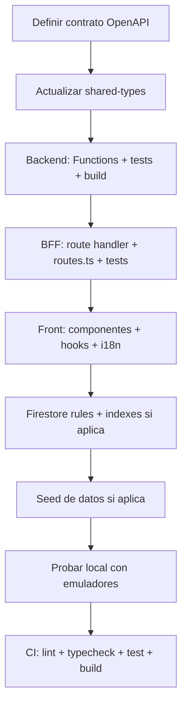

# Guía de Desarrollo — Procedimientos Estándar

> Checklist y pasos obligatorios para tareas recurrentes. Evita olvidos como no agregar rutas al catálogo.

---

## 1. Agregar endpoint al BFF (Next.js)

### Checklist obligatorio

| ✅ Paso | Archivo | Acción |
|---------|---------|--------|
| 1 | `packages/client/src/app/api/<endpoint>/route.ts` | Crear route handler (GET/POST/PUT/DELETE) |
| 2 | `packages/client/src/server/routes.ts` | **AGREGAR entrada al catálogo `ROUTES`** (¡paso crítico!) |
| 3 | `packages/client/src/server/<lógica>.ts` | Extraer lógica pura si hace falta (testeable) |
| 4 | `packages/client/src/server/<lógica>.test.ts` | Tests unitarios con vitest |
| 5 | `packages/client/src/app/api/<endpoint>/route.ts` | Importar y delegar a lógica pura |
| 6 | Ejecutar `npm run test` en `packages/client` | Verificar tests pasan |
| 7 | Ejecutar `npx tsc --noEmit` en `packages/client` | Verificar tipos |
| 8 | Probar con curl: `curl http://localhost:5002/api/<endpoint>` | Verificar 200 OK |

### Ejemplo: `GET /api/health`

**Archivo 1 — Lógica pura (`src/server/health.ts`):**
```typescript
export async function getHealth(): Promise<{ body: HealthResponse; status: number }> {
  const functionsHealth = await checkFunctionsHealth();
  // ...
}
```

**Archivo 2 — Route handler (`src/app/api/health/route.ts`):**
```typescript
import { getHealth } from '@/server/health';

export async function GET() {
  const { body, status } = await getHealth();
  return NextResponse.json({ success: status < 400, data: body, error: null }, { status });
}
```

**Archivo 3 — Catálogo (`src/server/routes.ts`):**
```typescript
export const ROUTES = [
  { method: 'GET', path: '/api/health', auth: 'public', internalPath: null },
  // ... resto
];
```

---

## 2. Agregar endpoint al Backend (Firebase Functions)

### Checklist obligatorio

| ✅ Paso | Archivo | Acción |
|---------|---------|--------|
| 1 | `packages/functions/src/<dominio>/<endpoint>.ts` | Implementar handler (`onRequest`, `onCall`, etc.) |
| 2 | `packages/functions/src/index.ts` | **Exportar la función** |
| 3 | `packages/functions/src/<dominio>/<endpoint>.test.ts` | Tests unitarios (vitest) |
| 4 | Ejecutar `npm run test` en `packages/functions` | Verificar tests |
| 5 | Ejecutar `npm run build` en `packages/functions` | Verificar build |
| 6 | Ejecutar `npm run lint` en `packages/functions` | Verificar lint |
| 7 | Probar con curl (emulador): `curl http://127.0.0.1:5001/<project>/us-central1/<fn>` | Verificar respuesta |

### Ejemplo: Health function

**`src/health.ts`:**
```typescript
export type HealthBody = { readonly status: 'ok'; readonly service: 'functions' };
export const HEALTH_OK: HealthBody = { status: 'ok', service: 'functions' };
```

**`src/index.ts`:**
```typescript
import { onRequest } from 'firebase-functions/v2/https';
import { HEALTH_OK } from './health';

export const health = onRequest((_req, res) => res.status(200).json(HEALTH_OK));
```

---

## 3. Agregar modelo de datos a Firestore

### Checklist obligatorio

| ✅ Paso | Archivo | Acción |
|---------|---------|--------|
| 1 | `docs/DATABASE.md` | Documentar colección/documento, campos, enums, reglas |
| 2 | `packages/shared-types/src/models/<model>.d.ts` | Tipos TypeScript (`Translatable`, enums, etc.) |
| 3 | `firestore.rules` | Agregar `match /<colección>/{docId}` con reglas read/write |
| 4 | `firestore.indexes.json` | Agregar índices compuestos si hay queries con rangos/filtros |
| 5 | `docs/ARCHITECTURE.md` | Actualizar tabla de índices si cambió |
| 6 | Script de seed si aplica (`firestore-seed.js`) | Agregar datos de prueba |

---

## 4. Agregar autenticación/autorización a ruta

### BFF (`packages/client/src/server/routes.ts`)

```typescript
{ method: 'GET', path: '/api/mi-ruta', auth: 'session', internalPath: '/api/v1/mi-ruta' },
```

**Valores de `auth`:**
- `'public'` — Sin sesión (ej. `/api/properties`, `/api/about`)
- `'session'` — Requiere cookie `__session` válida (JWT BFF)
- `'internal'` — Requiere `X-Internal-Key` (ej. `/api/revalidate`)

---

## 5. Actualizar OpenAPI (contratos)

### Archivos a tocar

| Archivo | Qué actualizar |
|---------|----------------|
| `docs/openapi.bff.yaml` | Esquema público (navegador ↔ BFF) |
| `docs/openapi.backend.yaml` | Esquema interno (BFF ↔ Functions) |
| `packages/shared-types/src/api/bff.gen.d.ts` | Tipos generados (si hay script de codegen) |
| `packages/shared-types/src/api/backend.gen.d.ts` | Tipos generados |

> **Nota:** En este proyecto el contrato es la fuente de verdad. Código debe adaptarse al contrato, no al revés.

---

## 6. Checklist de verificación pre-commit / pre-push

```bash
# En raíz del monorepo
npm run lint        # ESLint todos los workspaces
npm run format:check # Prettier
npm run typecheck   # tsc --noEmit todos los workspaces
npm run test        # vitest todos los workspaces
npm run build       # Build todos los workspaces
```

---

## 7. Tests — Qué testear y dónde

| Tipo | Qué | Dónde | Herramienta |
|------|-----|-------|-------------|
| **Unit** | Lógica pura (`src/lib`, `src/server`, `src/i18n`) | `packages/client/src/**/*.test.ts` | vitest |
| **Unit** | Functions handlers (`src/**/*.ts`) | `packages/functions/src/**/*.test.ts` | vitest |
| **Integración** | Emuladores (Auth, Firestore, Functions) | `firebase emulators:start` + scripts | firebase-functions-test |
| **E2E** | Flujos completos en navegador | `packages/client/e2e/**/*.spec.ts` | Playwright |

**Regla:** Los route handlers **no** se testean directo con vitest (excluidos en `vitest.config.ts`). Extraer lógica a `src/server/` y testear esa lógica.

---

## 8. Flujo típico: nueva feature end-to-end



---

## 9. Comandos útiles referencia rápida

```bash
# Emuladores con persistencia
firebase emulators:start --project=jf-propiedad-raiz \
  --import=/home/daniel/.firebase/emulators/firestore-data \
  --export-on-exit=/home/daniel/.firebase/emulators/firestore-data

# Seed admins
node firestore-seed.js

# Health checks
curl http://localhost:5002/api/health       # BFF
curl http://127.0.0.1:5001/jf-propiedad-raiz/us-central1/health  # Functions

# Tests
cd packages/client && npm run test
cd packages/functions && npm run test

# Build + lint + typecheck
cd packages/client && npm run build && npx tsc --noEmit
cd packages/functions && npm run build && npm run lint

# Ver logs
tail -f firestore-debug.log
tail -f firebase-debug.log
```

---

## 10. Errores comunes a evitar (anti-patterns)

| ❌ Error | ✅ Correcto |
|----------|-------------|
| Crear route handler sin agregarlo a `routes.ts` | **Siempre** agregar a `ROUTES` catálogo |
| Testear route handlers directo con vitest | Extraer lógica a `src/server/` y testear ahí |
| Cambiar código antes que contrato OpenAPI | Contrato primero → código después |
| Olvidar `internalPath: null` en rutas públicas | Revisar cada entrada de `ROUTES` |
| Hardcodear URLs de Functions en cliente | Usar `FUNCTIONS_BASE_URL` env var |
| Commit sin `npm run typecheck` | CI falla si no compila |

---

## 11. Referencias de arquitectura

| Documento | Qué contiene |
|-----------|--------------|
| `docs/ARCHITECTURE.md` | Arquitectura completa, capas, contratos |
| `docs/DATABASE.md` | Esquema Firestore, índices, enums |
| `docs/AUTHENTICATION.md` | Flujos auth, sesiones, headers |
| `docs/DEVELOPMENT-PLAN.md` | MT, dependencias, olas, asignación |
| `docs/DEVELOPMENT_GUIDE.md` | **Este archivo** — procedimientos estándar |

---

*Actualizar este archivo cada vez que surja un nuevo procedimiento estándar.*